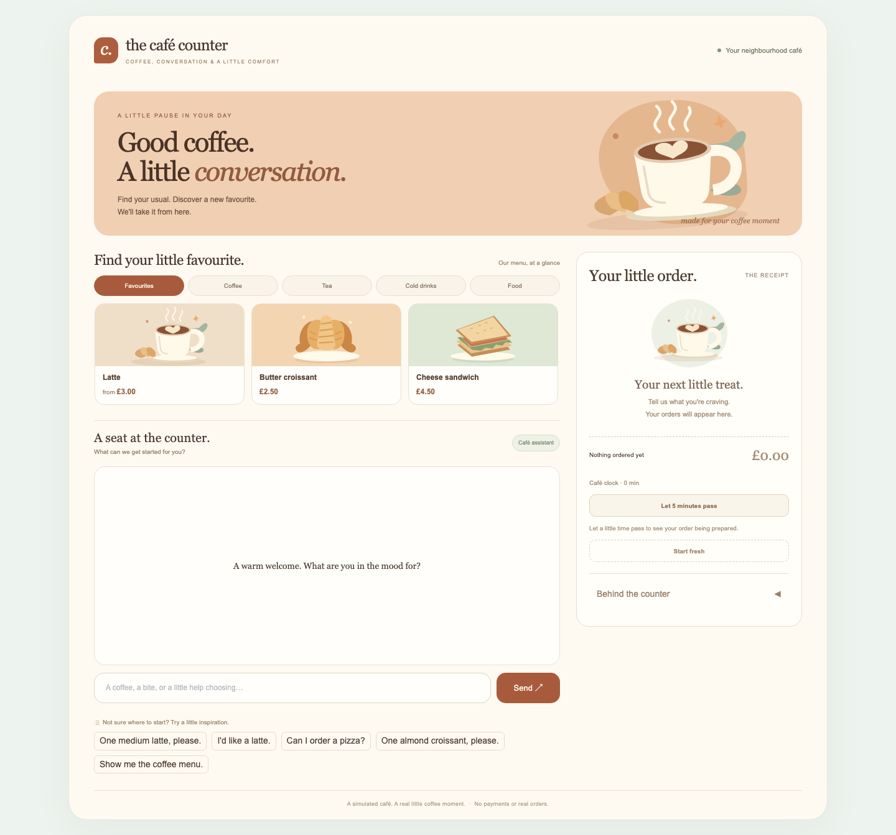
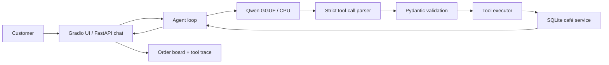
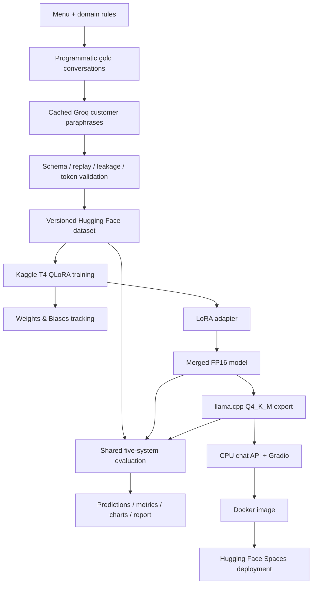

# Café Ordering Agent

[](https://github.com/PalakAnand30/cafe-tool-agent/actions/workflows/ci.yml)
[](https://github.com/PalakAnand30/cafe-tool-agent/actions/workflows/smoke_eval.yml)

### QLoRA fine-tuning · Structured tool calling · CPU inference · Full-stack ML

<!-- HEADLINE:START -->

An end-to-end ML engineering project for café tool calling, QLoRA fine-tuning and CPU serving. **Action + state success:** synthetic held-out — **S5 91.8% vs S3 57.5%**; independent 84-case Claude-authored set with Codex gold — **S4 33.3% (95% CI 22.6%–44.0%) vs S3 40.5% (95% CI 29.8%–51.2%)**. **The fine-tuned model overfits the synthetic data distribution.**

<!-- HEADLINE:END -->



[Results](#results) · [Architecture](#architecture) · [Tech stack](#tech-stack) ·
[Run locally](#run-locally) · [Reproduce](#reproduce-the-pipeline) ·
[Deployment](#deployment)

## Achievements

<!-- ACHIEVEMENTS:START -->

- **96.6% action accuracy** for the fine-tuned model on the held-out synthetic set.
- **+59.0 percentage points** in synthetic action-and-state success for merged fine-tuning over few-shot prompting.
- **0.99 GB GGUF export** for CPU inference, with **0 GPU layers**.
- **2,420 complete conversation runs + 5,095 next-action predictions** across the five-system comparison.
- **CPU latency: 9.51s p50 / 11.03s p95**, measured over 100 requests on Apple M5 with fresh KV context per request.

<!-- ACHIEVEMENTS:END -->

## What it does

The assistant translates customer requests into structured actions: browse the
menu, check availability, create an order, look up its status and cancel it.
A chat interface brings together conversational replies, an expandable tool trace,
menu cards and a live order board.

The engineering challenge is making generated actions agree with executable
business rules. Tool calls pass through strict JSON parsing, Pydantic schemas and
backend validation before they affect an order. The same contracts support data
creation, model training, evaluation and serving.

## Tech stack

| Layer | Technologies | Purpose |
| --- | --- | --- |
| Language and packaging | Python 3.11, uv, pinned lockfile | Reproducible, installable Python package |
| Backend and contracts | FastAPI, SQLite, Pydantic v2, Decimal | Validated tools, order state and exact monetary totals |
| Base model | Qwen2.5-1.5B-Instruct | Open-weight conversational tool calling |
| Fine-tuning | PyTorch, Transformers, PEFT, TRL, bitsandbytes | QLoRA with NF4 quantization and assistant-only supervision |
| GPU execution | Kaggle Tesla T4, Transformers; vLLM worker | Training and shared-schema GPU evaluation |
| Data and API baseline | Groq, GPT-OSS-120B | Cached customer paraphrases and a larger-model comparison |
| Experiment tracking | Weights & Biases, Hugging Face Hub | Training logs, versioned datasets and model artifacts |
| Quantization and serving | llama.cpp, GGUF Q4_K_M, llama-cpp-python | CPU model inference |
| Interface | Gradio, FastAPI chat API, CSS/SVG | Session-isolated chat, menu and order board |
| Evaluation | Shared runner, conversation bootstrap, Matplotlib | Metrics, confidence intervals, charts and error analysis |
| Delivery and quality | Docker, Hugging Face Spaces, GitHub Actions, pytest, Ruff | Container packaging, deployment tooling and automated checks |

## Architecture



### How a request works

1. The UI sends a customer message with its session ID to the chat API.
2. The agent renders the conversation and tool schemas using the pinned Qwen
   tokenizer and generates the next response.
3. The parser extracts a structured tool call and validates its arguments.
4. The café service applies availability, pricing and order-state rules, then
   returns a structured result to the agent.
5. The assistant replies, while the interface displays the actual tool trace
   and backend order state.

For example, “One medium latte, please” maps to the tool contract:

```json
{
  "name": "create_order",
  "arguments": {
    "items": [
      {"item_name": "latte", "size": "medium", "quantity": 1}
    ]
  }
}
```

Each session owns an isolated café backend. Preparation advances through an
explicit logical clock, which makes order-status and cancellation scenarios
replayable. Standalone menu browsing reads the same backend through a serving
helper; ordering uses the model-driven agent loop.

## End-to-end ML pipeline



### Data and training

<!-- DATA_TRAINING:START -->

| Split | Conversations | Construction |
| --- | --- | --- |
| Train | 3,500 | Backend-generated gold + Groq customer paraphrases |
| Validation | 300 | Backend-generated gold + Groq customer paraphrases |
| Test | 400 | Backend-generated gold + Groq customer paraphrases |
| Independent test | 84 | Claude customer messages + Codex gold |

| Training setting | Recorded run |
| --- | --- |
| GPU | Tesla T4 |
| LoRA rank / alpha / dropout | 16 / 32 / 0.05 |
| Full-conversation token budget | 4,096 |
| Batch × gradient accumulation | 1 × 16 |
| Epochs / learning rate | 3 / 0.0002 |
| Scheduler | cosine |
| Validation loss · initial → final | 1.00845 → 0.01044 |

[Weights & Biases training run](https://wandb.ai/palak-anand-the-university-of-edinburgh/cafe-tool-agent/runs/mz9t5xh9) · [Training manifest](results/training/training_manifest.json)

<!-- DATA_TRAINING:END -->

Gold tool calls, results and final states are generated against the actual café
backend. GPT-OSS-120B through Groq paraphrases customer wording, with entity
checks and response caching. Synthetic test template families and item/modifier
pairs are reserved before sampling; normalized customer text is checked across
splits for leakage. Every conversation is schema-validated, replayed and checked
against the full-conversation token budget.

Training uses NF4 with double quantization, FP16 compute and LoRA adapters on the
attention and feed-forward projections. The custom collator supervises assistant
payloads and closing tokens while masking customer/tool content. Gradient
checkpointing and accumulation keep full conversations within the T4 memory budget.

### Evaluation design

The shared evaluator compares zero-shot prompting, few-shot prompting, a larger
Groq model, merged fine-tuning and quantized CPU inference. Every system uses the
same tool schemas, prompt renderer, parser and café business rules.

It measures both next-action predictions from gold histories and complete agent
conversations on fresh backends. Append-only prediction files, source hashes,
model revisions and resumable manifests connect each reported metric to its run.
The independent benchmark preserves Claude customer-message authorship and Codex
gold annotation provenance.

## Results

<!-- RESULTS:START -->

### Synthetic held-out set · 400 conversations

| System | Action accuracy | Argument exact match | Action + state success |
| --- | --- | --- | --- |
| S1 · Base Qwen · zero-shot | 75.0% | 37.0% | 29.0% |
| S2 · Base Qwen · few-shot | 72.5% | 48.7% | 32.5% |
| S3 · GPT-OSS-120B · Groq | 81.2% | 67.6% | 57.5% |
| S4 · Fine-tuned Qwen · merged FP16 | 96.6% | 98.4% | 91.5% |
| S5 · Fine-tuned Qwen · CPU Q4_K_M | 96.2% | 100.0% | 91.8% |

### Independent LLM-authored set · 84 conversations

| System | Action accuracy | Argument exact match | Action + state success |
| --- | --- | --- | --- |
| S1 · Base Qwen · zero-shot | 51.7% [43.0%, 60.1%] | 51.3% [35.1%, 66.7%] | 26.2% [16.7%, 36.9%] |
| S2 · Base Qwen · few-shot | 46.2% [38.7%, 53.6%] | 23.1% [9.7%, 36.4%] | 21.4% [13.1%, 29.8%] |
| S3 · GPT-OSS-120B · Groq | 62.9% [54.1%, 71.4%] | 61.5% [45.2%, 77.6%] | 40.5% [29.8%, 51.2%] |
| S4 · Fine-tuned Qwen · merged FP16 | 62.9% [52.8%, 71.8%] | 46.2% [31.4%, 62.2%] | 33.3% [22.6%, 44.0%] |
| S5 · Fine-tuned Qwen · CPU Q4_K_M | 63.6% [53.6%, 72.3%] | 46.2% [31.6%, 61.1%] | 31.0% [21.4%, 41.7%] |

**Action accuracy** scores the next action from gold history. **Action + state success** requires the correct executed tool actions/arguments and final backend state across the complete conversation.

Synthetic customer wording uses GPT-OSS through Groq; independent customer messages are Claude-authored with Codex gold labels. Evaluation covers the configured café domain, with frozen lexical rules for clarification and decline.

Independent brackets show 95% conversation-bootstrap intervals (1,000 resamples, seed 42). S1/S2/S4 use Transformers FP16 on T4; S3 uses Groq; S5 uses CPU llama.cpp.


[Full evaluation report](results/report.md) · [Metrics and provenance](results/metrics.json) · [Error analysis](results/error_analysis.md)

<!-- RESULTS:END -->

The comparison distinguishes prompting, adaptation and quantization across the
two datasets. The [full report](results/report.md) includes per-intent scores,
confusion matrices, latency definitions and experiment provenance.

## Key finding: synthetic-data overfitting

The fine-tuned model overfits the synthetic data distribution. For the same merged
model, S4 action + state success falls from **91.5% on synthetic held-out data**
to **33.3% (95% CI 22.6%–44.0%)** on the independent set.
S3 moves from **57.5%** to **40.5% (95% CI 29.8%–51.2%)**.
Strong synthetic results therefore do not establish broader generalisation.
These are per-system intervals, not a paired significance test.

Likely contributors, rather than established causal findings:

- Template-derived training data concentrates repeated structures and domain patterns.
- A single paraphrase model's style limits linguistic diversity across synthetic splits.
- Near-zero validation loss (**0.01044**) suggests memorisation, though loss alone does not prove it.
- Checkpoint selection on in-distribution validation rewards fitting that same distribution.

### What I would do next

- **Evaluation audit:** review gold labels, lexical action scoring, leakage and intent coverage; version any corrections.
- **Broader training data:** use persona-diverse, multi-generator conversations and more varied interaction styles.
- **Shift-aware checkpoint selection:** select checkpoints on a separate distribution-shift dev set, keeping test sets untouched.
- **Human test data:** add human-authored conversations, such as coffee-ordering cases from [Taskmaster-1](https://github.com/google-research-datasets/Taskmaster/tree/master/TM-1-2019), with reviewed mappings to this café's tools.
- **CPU performance:** benchmark [prompt-prefix KV caching](https://github.com/ggml-org/llama.cpp/tree/master/tools/server#post-completion-given-a-prompt-it-returns-the-predicted-completion) for the shared system/tool prefix against the **9.5s p50** fresh-context baseline, comparing cold/warm latency and output correctness while preserving session isolation.

## Run locally

**Requirements:** Python 3.11, uv, a C/C++ compiler for the CPU build and a Hugging
Face token with read access to the configured model/dataset repositories.

```sh
git clone https://github.com/PalakAnand30/cafe-tool-agent.git
cd cafe-tool-agent
make setup
```

Create `.env` from `.env.example` if you do not already have one, then set
`HF_TOKEN` locally. Keep secret values in `.env`.

```sh
make setup-cpu
uv run --locked python scripts/download_models.py
make serve
```

Open **http://127.0.0.1:7860/**. Try placing an order, expand **Behind the counter**
to inspect tool calls, then check the order board. Use **Let 5 minutes pass** to
advance preparation and **Start fresh** to reset the session.

The chat API exposes `POST /chat` and `GET /health`. To run the café backend
separately with interactive API documentation:

```sh
uv run --locked uvicorn cafe_agent.backend.app:create_app --factory
```

Open **http://127.0.0.1:8000/docs** for the tool endpoints.

## Reproduce the pipeline

### 1. Validate the local package

```sh
make setup
make lint
make test
```

These checks use the installed package and the pinned tokenizer. The local
stack separates CPU/backend work from GPU execution in Kaggle notebooks.

### 2. Rebuild the data

Set `GROQ_API_KEY` in `.env` for customer paraphrasing, then run:

```sh
make data
make benchmark
```

The generator resumes from append-only journals and reuses cached API responses.
`make benchmark` converts the reviewed independent source into the shared
conversation schema. Data configuration lives in `configs/data.yaml`; the menu
and business rules live in `configs/domain.yaml`.

### 3. Train, export and evaluate on Kaggle

Follow the [Kaggle reproduction guide](docs/PHASE4_KAGGLE.md):

1. Open [train_kaggle.ipynb](notebooks/train_kaggle.ipynb) on a T4 runtime.
2. Set the exact pushed Git commit, dataset revision and base-model revision.
   Attach `HF_TOKEN` and `WANDB_API_KEY` through Kaggle Secrets; private GitHub
   access also uses a `GITHUB_TOKEN` secret.
3. Run training and export the adapter, merged weights and GGUF artifacts.
4. Set the exported merged revision in
   [eval_gpu_kaggle.ipynb](notebooks/eval_gpu_kaggle.ipynb), run evaluation and
   extract its prediction bundle into `results/predictions/`, retaining S3 files.

Use `make push-data` to publish a validated corpus to the configured private Hub
repository when training on a newly generated dataset. Keep dataset identities
and output directories distinct between experiments.

### 4. Run CPU inference and reproduce reports

Restore the pinned model and evaluation gold, then rebuild the published tables
from saved predictions:

```sh
uv run --locked python scripts/download_models.py
make report
make release-docs
```

For a fresh CPU model evaluation, write to a new run directory:

```sh
uv run --locked --extra cpu python -m cafe_agent.cpu.evaluate \
  --output-dir results/predictions/cpu-reproduction
```

The [CPU evaluation guide](docs/PHASE5_LOCAL.md) covers run selection, latency
measurement and aggregation. `make eval-s3` runs the cached Groq baseline;
`make latency` runs the separate CPU latency benchmark. `make smoke-eval` checks
a fixed sample of complete conversations against the configured regression threshold.

## Deployment

### Docker

With Docker running and the model/cache folders prepared by the local setup:

```sh
make docker-build
make docker-run
```

The image targets `linux/amd64`, uses a pinned CPU inference wheel and exposes
the chat app on **http://127.0.0.1:7860/**. Model files and tokenizer cache are
mounted at runtime; credentials come from the environment file. The container
runs as a non-root user.

### Hugging Face Spaces

Set `HF_USERNAME` and an `HF_TOKEN` with Space write permissions and model read
access in `.env`. Prepare the deployment bundle, then deploy it:

```sh
uv run --locked python scripts/deploy_space.py
uv run --locked python scripts/deploy_space.py --deploy --public
```

The deployment script creates or updates a public `HF_USERNAME/cafe-tool-agent` using
the Docker SDK, stores `HF_TOKEN` as a Space secret and uploads an allowlisted
application bundle. Startup downloads and SHA-256-verifies the pinned GGUF.
After deployment, check `/health`, open the chat interface and inspect an order's
tool trace. See the [serving guide](docs/PHASE6_DEMO.md) for runtime details.

## Engineering highlights

- **Shared contracts:** one schema registry and tool executor across data,
  training, evaluation, HTTP endpoints and serving.
- **Deterministic replay:** explicit clocks, seeded state, fresh SQLite backends
  and exact decimal money preserve executable ground truth.
- **Resumable experiments:** append-only predictions, request caches and immutable
  manifests make long data and inference jobs recoverable.
- **Traceable reporting:** generated README results, model cards and CV excerpts
  read persisted experiment evidence.
- **Automated delivery checks:** GitHub Actions defines locked setup, lint and
  unit tests, plus a manually triggered CPU smoke evaluation with retained artifacts.
- **Deployment packaging:** CPU Docker image, startup model verification,
  session isolation and an allowlisted Hugging Face Space bundle.

## Repository guide

| Path | Contents |
| --- | --- |
| `src/cafe_agent/backend`, `domain`, `tools` | Café API, business rules and validated tool execution |
| `src/cafe_agent/agent`, `parsing`, `prompting` | Agent loop, strict parsing and shared chat rendering |
| `src/cafe_agent/data` | Synthetic generation, paraphrasing, validation and label masking |
| `src/cafe_agent/kaggle`, `notebooks` | GPU training, export and evaluation workflows |
| `src/cafe_agent/cpu`, `eval`, `reporting` | CPU inference, scoring, charts and documentation generation |
| `src/cafe_agent/serve`, `docker` | Chat API, Gradio interface and container packaging |
| `configs`, `tests`, `.github/workflows` | Experiment settings, automated tests and CI definitions |
| `results` | Predictions, metrics, charts, reports and verification receipts |

## Artifacts and attribution

[Dataset card](docs/cards/dataset/README.md) ·
[LoRA adapter card](docs/cards/adapter/README.md) ·
[Merged model card](docs/cards/merged/README.md) ·
[GGUF model card](docs/cards/gguf/README.md)

Built on [Qwen2.5-1.5B-Instruct](https://huggingface.co/Qwen/Qwen2.5-1.5B-Instruct)
and [GPT-OSS-120B](https://huggingface.co/openai/gpt-oss-120b), whose model weights
use Apache-2.0. Customer paraphrases and the larger-model baseline use Groq.
Independent benchmark messages retain Claude authorship with Codex gold labels.
Model cards and experiment manifests retain revision and attribution details.

Project code is licensed under [Apache-2.0](LICENSE). Dataset content and rights
held by the owner use [CC BY 4.0](DATA_LICENSE.md), with Claude/Groq provenance
preserved. See [NOTICE](NOTICE) for attribution and licence scope.
