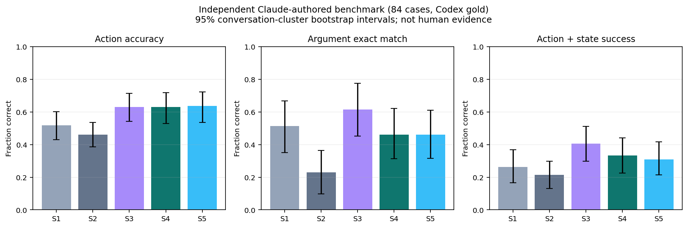

# Café Ordering Agent

A reproducible project to fine-tune Qwen2.5-1.5B-Instruct with QLoRA for café
ordering tool calls, compare prompting and fine-tuning, and serve the resulting
GGUF model on CPU. `PROJECT_SPEC.md` defines the full scope and working rules.

The café backend and agent core are implemented, together with the Phase 2
dataset pipeline, replay/token validation, assistant-only labels, human-test
annotation CLI, independent LLM benchmark conversion and private dataset publisher.
Training/export ran on Kaggle and S1/S2/S4 predictions were received and validated.
The GPT-OSS 120B S3 baseline is complete on both test sets. Phase 5 adds CPU-only
GGUF evaluation, a 100-request latency benchmark and the shared five-system report.
The CPU chat API, Gradio demo, Docker image and Space deployment script are
implemented. Results and limitations are shown below.

Follow the [Kaggle handoff](docs/PHASE4_KAGGLE.md) for GPU reproduction and the
[local Phase 5 guide](docs/PHASE5_LOCAL.md) for CPU setup, downloads, resumable
evaluation and deterministic report generation. The [demo guide](docs/PHASE6_DEMO.md)
covers the browser UI, chat API, Docker and private Space deployment.

## Local setup

Use Python 3.11 and [uv](https://docs.astral.sh/uv/). From the repository root:

```sh
make setup
make lint
make test
```

The src-layout distribution is named `cafe-tool-agent`; its Python import is
`cafe_agent`. The Python version and direct dependency versions are pinned;
`uv.lock` records the resolved environment. Local setup installs no GPU libraries.

When a later phase needs credentials, copy `.env.example` to `.env` only if
you do not already have one, then fill in the required values locally.
Never commit or share `.env`.

## Project layout

- `src/cafe_agent/`: domain, backend, tools, parser, prompting, clients,
  agent loop, dataset pipeline, local evaluation and session-isolated chat demo.
- `configs/domain.yaml`: menu, prices, supported modifiers, stock and timing.
- `configs/runtime.yaml`: decoding, caching, retry, CPU and agent settings.
  `data.yaml` controls generation; `train.yaml` pins the tokenizer/model revision.
- `tests/`: backend, tools, HTTP API, parser, agent, client, replay, leakage,
  masking, annotation and publishing tests.
- `scripts/`: data, evaluation and notebook build/validation entry points.
  `notebooks/` contains the two Kaggle workflows; `docker/` contains the CPU image.
- `data/`: generated data and API cache are ignored; human tests and small
  samples can be versioned.
- `results/`: versioned predictions, metrics, validation evidence and reports.
- `.github/workflows/ci.yml`: locked setup, lint and tests on pushes and PRs.
- `AGENTS.md` and `PROGRESS.md`: working rules, decisions and phase status.

## Commands and phase boundaries

`make setup`, `make setup-cpu`, `make lint`, `make test`, `make benchmark`, `make data`,
`make push-data`, `make eval-local` (S5), `make eval-s3`, `make latency` and
`make report`, `make serve`, `make docker-build` and `make docker-run` are implemented.
`uv run --locked python scripts/deploy_space.py` prepares a reviewable deployment
bundle; add `--deploy` only when ready to create/update the private Docker Space.

GPU training and inference run only on Kaggle T4 notebooks. Local GGUF
inference uses CPU only (`n_gpu_layers=0`, no K/Q/V offload).

## Café backend

Run the standalone café API from the repository root:

```sh
uv run --locked uvicorn cafe_agent.backend.app:create_app --factory
```

Visit `http://127.0.0.1:8000/docs` for the routes. The service persists orders
in the SQLite path configured in `configs/runtime.yaml`. This is the café
backend; the separate demo application exposes `/chat` and a Gradio UI on port 7860.

The API exposes `GET /health`, `GET /menu`, `POST /availability`,
`POST /orders`, `GET /orders/{order_id}`, `POST /orders/{order_id}/cancel`
and `POST /tools/{name}`. The tool route and in-process executor share exactly
the same Pydantic validation and structured domain errors. Money is represented
as decimal strings in GBP on the wire to preserve exact totals.

For replay and evaluation, create a fresh in-memory backend:

```python
from cafe_agent.backend.service import CafeService

cafe = CafeService()
try:
    result = cafe.call("create_order", {
        "items": [{"item_name": "latte", "size": "medium", "quantity": 1}]
    })
    cafe.advance_time(1)
    state = cafe.snapshot()
finally:
    cafe.close()
```

Order progression uses a persisted logical clock. `advance_time(minutes)`
changes it explicitly; status checks and elapsed wall-clock time do not.
Cancellation is allowed while received or preparing, and repeated cancellation
is idempotent. Seeded preparation estimates and IDs replay deterministically.

## Model clients and agent loop

`models.base.ModelClient` provides a shared message and response interface.
`GroqClient` uses native tool calling, reads `GROQ_API_KEY` through python-dotenv
on the first cache miss, caches raw responses by request hash, and retries
rate limits and server errors with exponential backoff and jitter.

`LlamaCppClient` lazy-loads the optional `cpu` extra, fixes `n_gpu_layers=0`,
and accepts a tokenizer so it can use the shared Qwen chat-template renderer.
Phase 5's `cpu.CPUClient` also verifies identical Qwen prompt token IDs and
uses unpenalized greedy decoding. The lazy HF/vLLM workers under
`cafe_agent.kaggle` are used by the Phase 4 notebooks. The old `models.kaggle`
stubs are retained for frozen S3 provenance. Importing the package loads no GPU libraries.

`Agent.run(messages)` accepts caller-owned history, validates every generated
call before execution, appends tool results with matching IDs, and returns a
reply, history and trace. It stops on malformed output, reused call IDs or the
configured round limit. Core protocol behaviour is tested with scripted responses
and mock transports. S3 model quality is measured by the evaluator below.

## Generate and validate the dataset

Set `GROQ_API_KEY` in your existing `.env`, then run:

```sh
make data
```

The user-approved paraphraser and S3 baseline are `openai/gpt-oss-120b`
through Groq with low reasoning effort. The originally specified Llama model
was unavailable to the configured account. This project does not use the OpenAI
API for these requests.

The job writes append-only gold drafts and final train/validation/test JSONL
under the configured `data/generated-independent-v1/`, caches every successful
Groq response in `data/cache/`,
and resumes completed IDs and paraphrase batches. A manifest rejects changed
inputs or code; use a new `--output-dir` when intentionally making a new version.
Do not delete the cache to retry an interrupted job.

Only customer utterances are paraphrased. Protected entities and complete order
lines are verified; rejected paraphrases fall back to the original utterance.
Assistant tool calls, backend results and varied replies are programmatic.
Reserved template families and item/modifier pairs belong exclusively to test,
and normalized customer text is deduplicated across all synthetic splits.

Every conversation validates its tool calls, replays stored results and final
state against a fresh backend, and fits the pinned Qwen template under the
user-approved full-conversation token budget. Assistant-token masking uses
template-aligned character spans and fast-tokenizer offsets; it never truncates
or labels customer/tool text as an assistant target. See
`data/generated-independent-v1/stats.md` for measured counts, lengths and rejection rates.

Regenerate the versioned review sample and validation evidence from those files:

```sh
uv run --locked python scripts/collect_data_artifacts.py
```

The resulting `data/samples/` and `results/data_validation.json` contain gold
data validation evidence, not model evaluation results.

An explicit offline variant is available for development. It records that no
API paraphrasing ran and uses a separate output directory:

```sh
uv run --locked python -m cafe_agent.data.generator --no-paraphrase --output-dir data/offline
```

## Convert the independent benchmark, then publish privately

The user approved an independent LLM-authored benchmark instead of the original
human-written requirement. The supplied 84 cases retain `author=claude` and every
customer message. Codex reviewed gold actions and intent labels for the current
menu, without adopting the supplied replacement domain or its seeded orders.
This is LLM-authored evidence, with Codex labels, and must never be reported as
human-written or real-customer performance.

```sh
make benchmark
```

The immutable source is `data/human_test/human_test_authoring.yaml`; current-domain
gold revisions and reasons are in `data/human_test/gold_overrides.yaml`. The converter
checks source/domain hashes, replays calls on fresh backends, derives tool results
and final states, and validates the token budget. Output is
`data/human_test/independent_test.jsonl`, with separate customer-author and gold-annotator
provenance. Measured counts, intent coverage and token lengths are in
`results/independent_validation.json`. Labels were revised before any model evaluation.

The file `data/human_test/human_test.jsonl` contains clearly marked
`author=codex_example` worked examples. They are excluded by the shared human
loader and never count toward the independent benchmark. The original interactive
CLI remains available for optional genuine human data:
`uv run --locked python scripts/annotate_human_test.py`. Report that slice separately.

Then set `HF_TOKEN` (dataset write permission) and `HF_USERNAME` in `.env` and run:

```sh
uv run --locked python scripts/push_dataset.py --dry-run
make push-data
```

The dry run stages validated files without contacting the Hub. Upload requires
the configured independent benchmark count, checks zero normalized overlap with
synthetic customer text, and creates a private
`<HF_USERNAME>/cafe-tool-calls` dataset. Synthetic splits use its default config;
independent_test is a separate config. The legacy human_test config retains the
excluded worked examples. Existing public repositories are rejected.
Read raw JSONL files from the Hub to preserve omitted argument fields; Arrow
inference can fill missing nested keys with null. Make the dataset public only
when the project is ready.

Keeping the existing menu changes many original order cases into declines.
The independent benchmark therefore has limited successful multi-item-order
coverage and a high share of unsupported requests. Its wording and gold labels
may share LLM biases. Any later bootstrap intervals describe variation within
this case set, not performance on real customers.

## Local baseline evaluation

```sh
make eval-s3
uv run --locked python scripts/evaluate.py --metrics-only
```

The first command runs S3 (`openai/gpt-oss-120b` through Groq) with the shared
system prompt and tool schemas, temperature 0, a 512-token response cap, seed 42
and low reasoning effort. It validates both test sets before making requests,
then completes both modes per conversation. Every gold assistant turn is scored
from its gold history. End-to-end runs use the real agent and a fresh backend,
with recorded logical-time advances anchored to user turns. The Claude-authored
independent set runs first; the synthetic held-out test follows.

Predictions append to `results/predictions/S3__{split}.jsonl` using one versioned
Pydantic schema. A manifest pins input files, decoding, shared prompt/tools and
inference code. Re-runs skip completed keys and use cached Groq responses;
interrupted final JSONL writes are backed up before repair. Changed inputs or
inference code require a new output directory. Do not run two writers in one
directory. Provider-rejected tool generations count as invalid outputs;
connectivity/authentication/quota failures stop the run and preserve progress.

Tool IDs and JSON histories are serialized canonically across both modes and
all future systems. Argument scoring normalizes schema defaults and ignores
modifier/item ordering while preserving quantities, duplicate lines and item
bindings. Missing or wrong tool calls count as incorrect argument predictions.
Plain-text actions use fixed lexical rules, with no model judge; replies after
tool results count as replies. These rules do not assess reply factuality or
whether a clarification asks for the right detail.

`end_to_end_success` checks final state and clean agent termination. A no-op
response can leave an empty state unchanged, so the stricter
`action_and_state_success` additionally checks each user-turn action/arguments
and missing/extra tool calls. Both are reported. All order IDs, money, quantities,
customer names, statuses and logical times are retained in state comparison.

The second command recomputes metrics and the table locally without model/API
access. `results/metrics.json` includes field-level F1, clarification/decline
precision and recall, per-intent breakdowns, confusion matrices, latency and
cost assumptions. Complete independent-set metrics have 95% percentile
bootstrap intervals using conversation clusters. Partial runs are labelled and
have no confidence intervals. Undefined metrics are `null`.

S3 latency includes the network and retries, excludes explicit quota pacing and
local cache hits, and must not be described as CPU inference latency. Cost is
a cold paid-equivalent estimate, not an actual bill; free-plan pricing and
provider input-cache discounts are excluded. See the dated source and usage
coverage in `results/metrics.json` and the table in `results/S3_baseline.md`.

<!-- RESULTS:START -->
| System | Set | Coverage (turn / end) | Action accuracy | Argument exact | Field F1 | End success | Action + state |
| --- | --- | --- | --- | --- | --- | --- | --- |
| S1 | independent_test (complete) | 143/143 turns; 84/84 conversations | 51.7% [43.0%, 60.1%] | 51.3% [35.1%, 66.7%] | 34.3% [19.6%, 50.0%] | 76.2% [66.7%, 84.5%] | 26.2% [16.7%, 36.9%] |
| S1 | test (complete) | 876/876 turns; 400/400 conversations | 75.0% | 37.0% | 47.3% | 43.8% | 29.0% |
| S2 | independent_test (complete) | 143/143 turns; 84/84 conversations | 46.2% [38.7%, 53.6%] | 23.1% [9.7%, 36.4%] | 38.8% [17.8%, 60.1%] | 79.8% [71.4%, 88.1%] | 21.4% [13.1%, 29.8%] |
| S2 | test (complete) | 876/876 turns; 400/400 conversations | 72.5% | 48.7% | 66.3% | 57.5% | 32.5% |
| S3 | independent_test (complete) | 143/143 turns; 84/84 conversations | 62.9% [54.1%, 71.4%] | 61.5% [45.2%, 77.6%] | 49.3% [28.3%, 69.4%] | 82.1% [73.8%, 89.3%] | 40.5% [29.8%, 51.2%] |
| S3 | test (complete) | 876/876 turns; 400/400 conversations | 81.2% | 67.6% | 72.4% | 69.5% | 57.5% |
| S4 | independent_test (complete) | 143/143 turns; 84/84 conversations | 62.9% [52.8%, 71.8%] | 46.2% [31.4%, 62.2%] | 29.4% [18.0%, 42.1%] | 73.8% [63.1%, 83.3%] | 33.3% [22.6%, 44.0%] |
| S4 | test (complete) | 876/876 turns; 400/400 conversations | 96.6% | 98.4% | 95.6% | 96.0% | 91.5% |
| S5 | independent_test (complete) | 143/143 turns; 84/84 conversations | 63.6% [53.6%, 72.3%] | 46.2% [31.6%, 61.1%] | 34.2% [21.7%, 46.9%] | 75.0% [65.5%, 83.3%] | 31.0% [21.4%, 41.7%] |
| S5 | test (complete) | 876/876 turns; 400/400 conversations | 96.2% | 100.0% | 94.9% | 97.8% | 91.8% |

The independent benchmark contains 84 Claude-authored cases with Codex gold labels, not human or real-customer evidence. It is weighted toward unsupported requests and has limited successful multi-item-order coverage. Synthetic templates and LLM wording can bias results. Intervals reflect case-sampling uncertainty, not real-world generalization. Plain-text actions use frozen approximate lexical rules; reply factuality and which detail was clarified are not judged. State-only success can overstate clarification, decline and lookup performance; action + state is the stronger endpoint. Hardware, quantization, tokenizer/runtime numerics and inference backends differ.

See [the full report](results/report.md) for execution, latency and cost provenance.


<!-- RESULTS:END -->

Continue one phase at a time, following Section 0 of `PROJECT_SPEC.md`.
