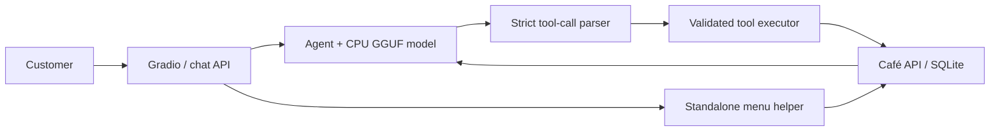
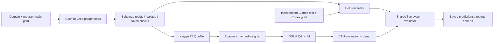

# Café Ordering Agent

<!-- HEADLINE:START -->
A café ordering agent with a validated SQLite tool backend, a QLoRA-trained Qwen2.5-1.5B model and a CPU chat demo. The exported Q4_K_M model achieved **91.8%** action-and-state success on 400 synthetic cases and **31.0% [21.4%, 41.7%]** on 84 independent Claude-authored cases with Codex gold labels. The larger GPT-OSS model through Groq reached **40.5% [29.8%, 51.2%]** on the independent set. These are LLM-authored benchmarks, not customer evidence.
<!-- HEADLINE:END -->

## Try the café counter


The cream-and-espresso chat interface includes a menu, tool trace and order
board. The screenshot is a UI preview, not benchmark evidence.
**Demo GIF: pending. Live Space: deployment deferred.** The planned destination
is [PalakAnand30/cafe-tool-agent](https://huggingface.co/spaces/PalakAnand30/cafe-tool-agent);
it is not a working-demo claim and may be unavailable or private.

From a clone, use Python 3.11, uv and a C/C++ compiler:

```sh
make setup
# Create .env from .env.example only if you do not already have one.
# Set HF_TOKEN locally with read access to the private model and dataset.
make setup-cpu
uv run --locked python scripts/download_models.py
make serve
```

Open `http://127.0.0.1:7860/`. Try “One medium latte, please”, inspect the tool
trace, then check or cancel the order. Each browser session has its own backend.
The CPU model is lazy-loaded; initial download/startup takes longer than a warm reply.
Standalone menu browsing has a serving-only helper with real backend traces;
orders use the model. These conveniences are excluded from the benchmark.

For API routes, Docker and optional private Space deployment, see the
[demo guide](docs/PHASE6_DEMO.md). Local use does not require a Space deployment.

## Architecture





Tool schemas, prompt renderer, strict parser, backend state and logical clock
are shared across systems. The backend uses decimal money strings and only
advances time through explicit `advance_time(minutes)` calls. Invalid JSON is
never repaired. The demo and benchmark use separate session/state storage.

## Results

S1 is the base model, S2 adds frozen few-shot examples, S3 is
`openai/gpt-oss-120b` through **Groq** at low reasoning effort, S4 is the merged
fine-tuned model, and S5 is its CPU GGUF export. S1/S2/S4 actually ran with the
recorded **Transformers float16 fallback on T4**, rather than vLLM. The bundle
did not preserve the reason for that fallback.

Action/argument accuracy uses gold histories. End-to-end runs replay complete
scripted customer conversations against fresh backends. **Action + state**
requires the correct calls/arguments and final state; state-only success can
reward an empty backend after an incorrect reply. Textual clarification and
decline recognition uses frozen approximate lexical rules and does not verify
reply factuality. Independent intervals resample complete cases, not turns.

<!-- RESULTS:START -->
| System | Set | Coverage (turn / end) | Action accuracy | Argument exact | Field F1 | End success | Action + state |
| --- | --- | --- | --- | --- | --- | --- | --- |
| S1 | independent_test (complete) | 143/143 turns; 84/84 conversations | 51.7% [43.0%, 60.1%] | 51.3% [35.1%, 66.7%] | 34.3% [19.6%, 50.0%] | 76.2% [66.7%, 84.5%] | 26.2% [16.7%, 36.9%] |
| S1 | test (complete) | 876/876 turns; 400/400 conversations | 75.0% | 37.0% | 47.3% | 43.8% | 29.0% |
| S2 | independent_test (complete) | 143/143 turns; 84/84 conversations | 46.2% [38.7%, 53.6%] | 23.1% [9.7%, 36.4%] | 38.8% [17.8%, 60.1%] | 79.8% [71.4%, 88.1%] | 21.4% [13.1%, 29.8%] |
| S2 | test (complete) | 876/876 turns; 400/400 conversations | 72.5% | 48.7% | 66.3% | 57.5% | 32.5% |
| S3 | independent_test (complete) | 143/143 turns; 84/84 conversations | 62.9% [54.1%, 71.4%] | 61.5% [45.2%, 77.6%] | 49.3% [28.3%, 69.4%] | 82.1% [73.8%, 89.3%] | 40.5% [29.8%, 51.2%] |
| S3 | test (complete) | 876/876 turns; 400/400 conversations | 81.2% | 67.6% | 72.4% | 69.5% | 57.5% |
| S4 | independent_test (complete) | 143/143 turns; 84/84 conversations | 62.9% [52.8%, 71.8%] | 46.2% [31.4%, 62.2%] | 29.4% [18.0%, 42.1%] | 73.8% [63.1%, 83.3%] | 33.3% [22.6%, 44.0%] |
| S4 | test (complete) | 876/876 turns; 400/400 conversations | 96.6% | 98.4% | 95.6% | 96.0% | 91.5% |
| S5 | independent_test (complete) | 143/143 turns; 84/84 conversations | 63.6% [53.6%, 72.3%] | 46.2% [31.6%, 61.1%] | 34.2% [21.7%, 46.9%] | 75.0% [65.5%, 83.3%] | 31.0% [21.4%, 41.7%] |
| S5 | test (complete) | 876/876 turns; 400/400 conversations | 96.2% | 100.0% | 94.9% | 97.8% | 91.8% |

The independent benchmark contains 84 Claude-authored cases with Codex gold labels, not human or real-customer evidence. It is weighted toward unsupported requests and has limited successful multi-item-order coverage. Synthetic templates and LLM wording can bias results. Intervals reflect case-sampling uncertainty, not real-world generalization. Plain-text actions use frozen approximate lexical rules; reply factuality and which detail was clarified are not judged. State-only success can overstate clarification, decline and lookup performance; action + state is the stronger endpoint. Hardware, quantization, tokenizer/runtime numerics and inference backends differ.

See [the full report](results/report.md) for execution, latency and cost provenance.


<!-- RESULTS:END -->

The [full report](results/report.md), [error analysis](results/error_analysis.md),
[machine-readable metrics](results/metrics.json) and
[evidence-based CV bullets](results/cv_bullets.md) retain the limitations and
provenance. `make report` regenerates metrics from preserved predictions;
`make release-docs` refreshes README excerpts and local Hub cards from saved results.
No performance numbers are hand-edited into these excerpts.

## Dataset and training

<!-- DATA_TRAINING:START -->
Synthetic splits: **3,500 train / 300 validation / 400 test**. Separate independent set: **84 Claude-authored conversations**, with Codex gold labels; **0 genuine human cases** and **5 excluded worked examples**.

Training used a Tesla T4, LoRA rank 16, 4,096-token full conversations, batch 1 × accumulation 16, 3 epochs and learning rate 0.0002. Measured GPU-worker time: 5.59 hours (not billing). Validation loss: 1.00845 → 0.01044; this is not test accuracy. Assistant payloads and closing tokens are supervised; user and tool content is masked. No conversation truncation.

[Training run](https://wandb.ai/palak-anand-the-university-of-edinburgh/cafe-tool-agent/runs/mz9t5xh9) · [Original metadata](results/training/training_manifest.json) · [Dataset validation](results/independent_validation.json)
<!-- DATA_TRAINING:END -->

Training customer wording was paraphrased by GPT-OSS through Groq, with cached
responses and entity checks; assistant calls/results came from the deterministic
backend. This uses the Groq API, not the OpenAI API. Synthetic test template
families and item/modifier pairs were reserved before sampling, and normalized
customer-text leakage was checked across synthetic splits. Independent customer
messages retain Claude authorship; Codex gold changes are recorded separately.
The historical `human_test` path does not imply human-authored evidence.

Prepared cards: [dataset](docs/cards/dataset/README.md),
[adapter](docs/cards/adapter/README.md), [merged](docs/cards/merged/README.md),
[GGUF](docs/cards/gguf/README.md). These are local review copies, not uploaded
replacements. Hub model/data repositories remain private at the recorded handoff.

## Reproduce

A fresh clone can run the installed-package checks without weights or CUDA:

```sh
make setup
make lint
make test
```

Tests cache only the pinned tokenizer/config files. Add the CPU extra explicitly
for inference; normal setup excludes it. Do not install CUDA torch, bitsandbytes,
vLLM or MLX on the Mac. CPU inference uses zero GPU layers and no K/Q/V offload.
The evaluated Mac native build and the Linux Docker wheel use different pinned
llama-cpp-python versions; a full Linux model benchmark has not been recorded.

| Task | Entry point / guide |
| --- | --- |
| Restore private GGUF and gold tests | `uv run --locked python scripts/download_models.py` |
| Run S5 and its latency benchmark | `make eval-local`, then `make latency`; [CPU guide](docs/PHASE5_LOCAL.md) |
| Score all preserved predictions offline | `make report` |
| Refresh README and review cards | `make release-docs` |
| Generate synthetic data with cached Groq calls | `make data` (API access needed on cache misses) |
| Convert the reviewed independent set | `make benchmark` |
| Repeat GPU training/export and evaluation | [Kaggle guide](docs/PHASE4_KAGGLE.md) |
| Run the café backend alone | `uv run --locked uvicorn cafe_agent.backend.app:create_app --factory` |
| Chat, Docker and optional deployment | [Demo guide](docs/PHASE6_DEMO.md) |
| CPU regression guard and release steps | [Phase 7 checklist](docs/PHASE7_PUBLICATION.md) |

Generated gold data, API caches and weights are ignored by Git. Model/gold
restoration needs a read-enabled `HF_TOKEN`; running checks against saved
predictions does not need a model API key. Fresh-clone report reproduction needs
the restored gold files in addition to committed predictions. Changed inference
inputs require a new output directory; keep old manifests, checkpoints and API cache.

## CI and smoke evaluation

Push/PR CI installs the locked environment, caches the tokenizer, runs Ruff and
pytest. A separate manual `CPU smoke evaluation` workflow downloads the pinned
private GGUF and data and executes the configured sample of full synthetic test
conversations. It requires a repository `HF_TOKEN` secret, uploads evidence even
when scoring fails, and enforces the action-and-state threshold in
`configs/eval.yaml`. It does not run on every push.

The smoke settings are an explicit YAML comment pragma so the historical strict
`EvalConfig` and inference manifests retain their frozen meaning. The regression
sample and threshold are engineering checks; they do not replace the independent
benchmark. Local checks are recorded in `PROGRESS.md`; remote workflow execution
is pending until the owner pushes and triggers it. See the checklist for commands.

## Limits and publication status

The benchmark covers one configured café domain. Successful multi-item independent
orders are scarce; unsupported requests are overrepresented. Real demo failures
included modifier handling and an invalid food-category argument. The menu helper
improves browsing without establishing better model performance. Orders, prices,
allergies and payments have not been validated for real customer use.

Latency mixes local CPU, T4 and remote API hardware. The separate CPU latency
benchmark resets KV context; normal evaluation can reuse prefixes. Groq cost is a
dated paid-equivalent estimate, and CPU cost uses an illustrative hourly assumption.
Neither is an invoice. See the report for exact definitions.

The local demo works. Live Space deployment and the GIF remain deferred by the
owner. Docker startup/UI/health passed; an emulated Docker chat timed out, so a
completed Docker model-chat check remains pending. Nothing in Phase 7 publishes
repositories or changes visibility. Follow the [publication checklist](docs/PHASE7_PUBLICATION.md)
when ready.

## Licenses and attribution

The [Qwen base weights](https://huggingface.co/Qwen/Qwen2.5-1.5B-Instruct/blob/989aa7980e4cf806f80c7fef2b1adb7bc71aa306/LICENSE)
and [GPT-OSS paraphraser weights](https://huggingface.co/openai/gpt-oss-120b/blob/main/LICENSE)
use Apache-2.0. No GPT-OSS weights are distributed here. Preserve applicable
upstream licenses/notices and derivative attribution when distributing model files.
That model license does not assign a license to this repository's code, generated
data or supplied Claude benchmark. Code/data license choices and permission to
redistribute the supplied benchmark require the owner's review before publication.

`PROJECT_SPEC.md` is the source of truth. `PROGRESS.md` records actual runs,
version decisions and known issues. Legacy model-client stubs are intentionally
retained because their hashes are part of frozen evaluation provenance.
