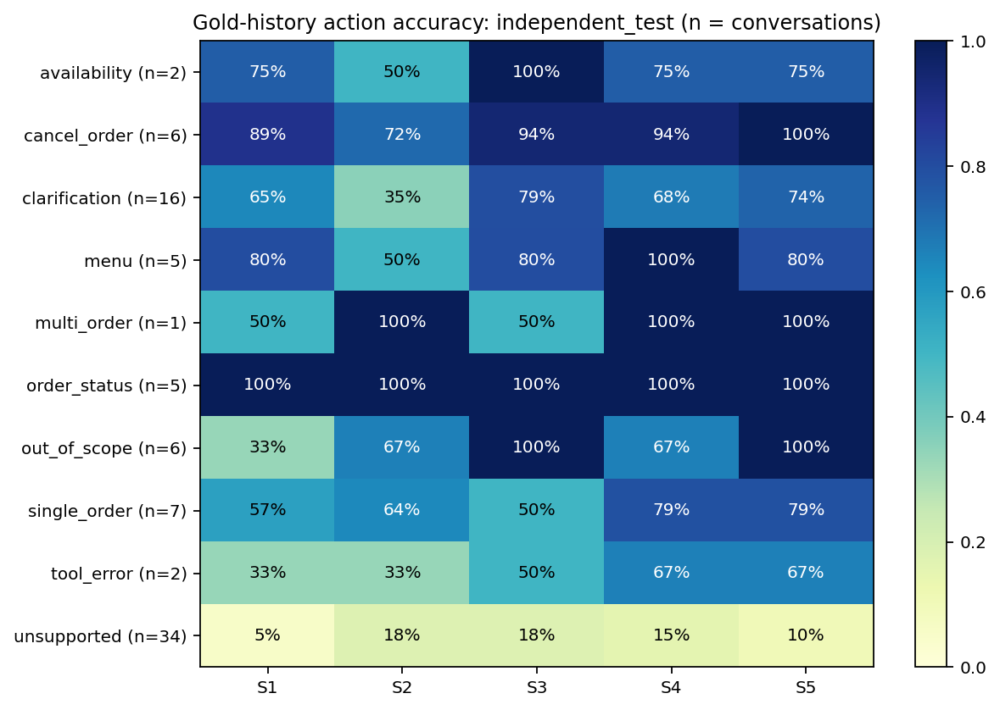
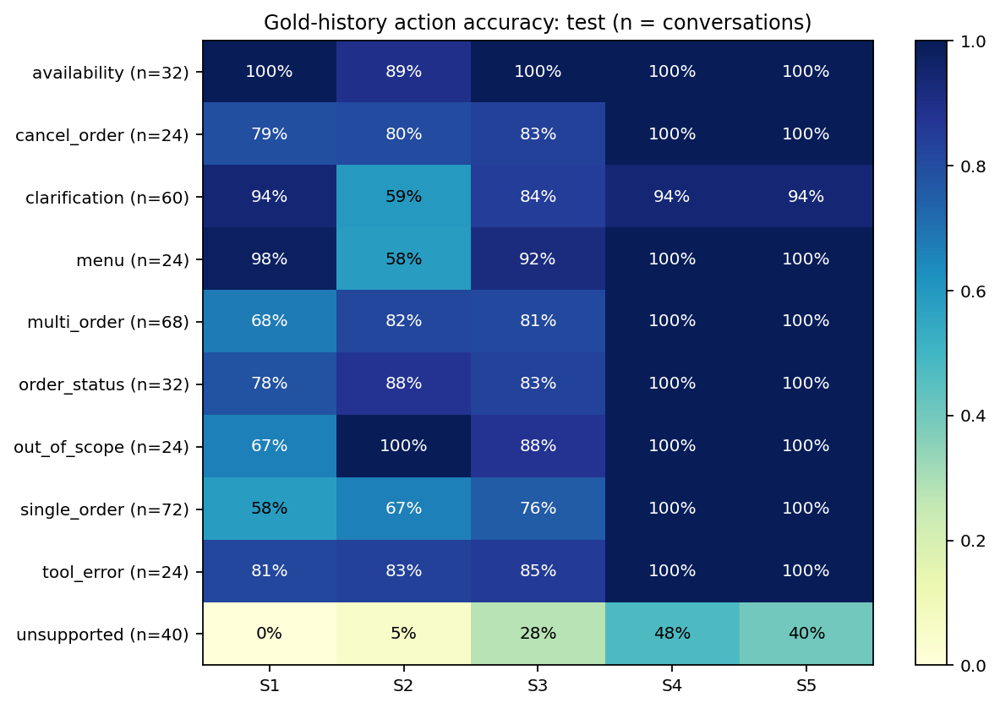
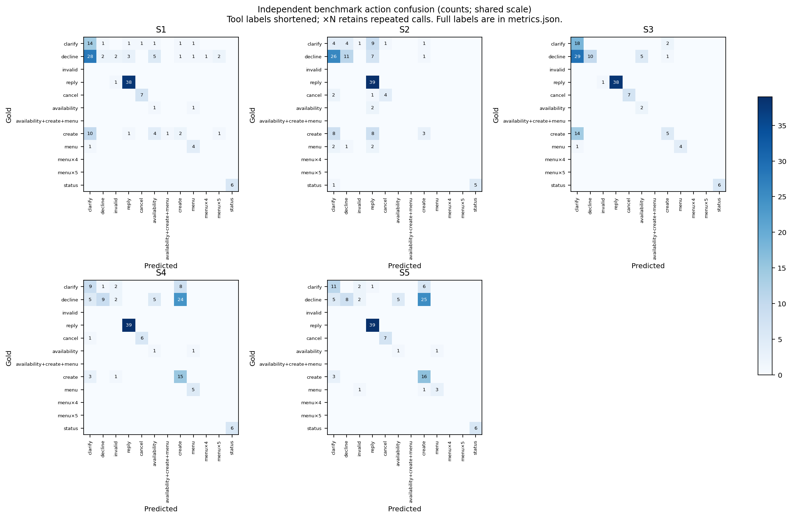
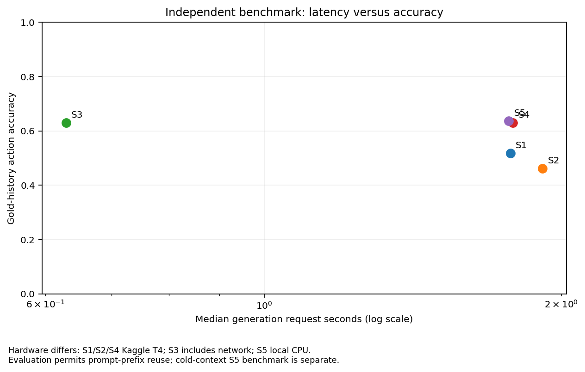

# Five-system evaluation report

| System | Set | Coverage (turn / end) | Action accuracy | Argument exact | Field F1 | End success | Action + state |
| --- | --- | --- | --- | --- | --- | --- | --- |
| S1 | independent_test (complete) | 143/143 turns; 84/84 conversations | 51.7% [43.0%, 60.1%] | 51.3% [35.1%, 66.7%] | 34.3% [19.6%, 50.0%] | 76.2% [66.7%, 84.5%] | 26.2% [16.7%, 36.9%] |
| S1 | test (complete) | 876/876 turns; 400/400 conversations | 75.0% | 37.0% | 47.3% | 43.8% | 29.0% |
| S2 | independent_test (complete) | 143/143 turns; 84/84 conversations | 46.2% [38.7%, 53.6%] | 23.1% [9.7%, 36.4%] | 38.8% [17.8%, 60.1%] | 79.8% [71.4%, 88.1%] | 21.4% [13.1%, 29.8%] |
| S2 | test (complete) | 876/876 turns; 400/400 conversations | 72.5% | 48.7% | 66.3% | 57.5% | 32.5% |
| S3 | independent_test (complete) | 143/143 turns; 84/84 conversations | 62.9% [54.1%, 71.4%] | 61.5% [45.2%, 77.6%] | 49.3% [28.3%, 69.4%] | 82.1% [73.8%, 89.3%] | 40.5% [29.8%, 51.2%] |
| S3 | test (complete) | 876/876 turns; 400/400 conversations | 81.2% | 67.6% | 72.4% | 69.5% | 57.5% |
| S4 | independent_test (complete) | 143/143 turns; 84/84 conversations | 62.9% [52.8%, 71.8%] | 46.2% [31.4%, 62.2%] | 29.4% [18.0%, 42.1%] | 73.8% [63.1%, 83.3%] | 33.3% [22.6%, 44.0%] |
| S4 | test (complete) | 876/876 turns; 400/400 conversations | 96.6% | 98.4% | 95.6% | 96.0% | 91.5% |
| S5 | independent_test (complete) | 143/143 turns; 84/84 conversations | 63.6% [53.6%, 72.3%] | 46.2% [31.6%, 61.1%] | 34.2% [21.7%, 46.9%] | 75.0% [65.5%, 83.3%] | 31.0% [21.4%, 41.7%] |
| S5 | test (complete) | 876/876 turns; 400/400 conversations | 96.2% | 100.0% | 94.9% | 97.8% | 91.8% |

Action and argument metrics use gold histories; end metrics execute the full agent. Brackets are 95% conversation-cluster percentile bootstrap intervals on the complete independent set (1,000 resamples, seed 42). Undefined metrics are null, displayed as —.

## Execution provenance

| System | Model | Backend / device |
| --- | --- | --- |
| S1 | Qwen/Qwen2.5-1.5B-Instruct | transformers / Tesla T4 |
| S2 | Qwen/Qwen2.5-1.5B-Instruct | transformers / Tesla T4 |
| S3 | openai/gpt-oss-120b | groq / remote API |
| S4 | PalakAnand30/cafe-agent-qwen2.5-1.5b-lora-merged | transformers / Tesla T4 |
| S5 | PalakAnand30/cafe-agent-qwen2.5-1.5b-lora-gguf | llama.cpp / arm64 |

## Observed comparisons

On independent_test, S4 action accuracy is 62.9%, versus S2 46.2% and S3 62.9%. Stronger action-and-state success is S4 33.3%, S2 21.4%, S3 40.5%.

On test, S4 action accuracy is 96.6%, versus S2 72.5% and S3 81.2%. Stronger action-and-state success is S4 91.5%, S2 32.5%, S3 57.5%.

These are observed point comparisons; individual bootstrap intervals do not establish significance of a paired difference. Training-loss reduction alone does not establish superiority over the larger prompted model.

S1/S2/S4 used the recorded Transformers fallback, float16 on T4. The supplied bundle does not record why vLLM was unavailable. S5 uses Q4_K_M, n_gpu_layers=0, no K/Q/V offload and a CPU-only build. All systems use the same prompt/tools, temperature 0, seed 42 and 512 generated-token limit.

## Detailed metrics

| System / set | Valid tool calls | Clarify P / R | Decline P / R |
| --- | --- | --- | --- |
| S1 / independent_test | 95.3% [87.7%, 100.0%] | 26.4% [14.6%, 37.9%] / 70.0% [50.0%, 88.2%] | 66.7% [0.0%, 100.0%] / 4.4% [0.0%, 11.1%] |
| S1 / test | 91.8% | 25.2% / 96.7% | 100.0% / 25.0% |
| S2 / independent_test | 93.8% [80.0%, 100.0%] | 9.3% [1.9%, 19.4%] / 20.0% [4.3%, 38.9%] | 68.8% [42.9%, 90.9%] / 24.4% [11.1%, 38.1%] |
| S2 / test | 97.1% | 25.8% / 13.3% | 31.0% / 40.6% |
| S3 / independent_test | 100.0% [100.0%, 100.0%] | 29.0% [17.2%, 41.2%] / 90.0% [72.7%, 100.0%] | 100.0% [100.0%, 100.0%] / 22.2% [10.6%, 35.4%] |
| S3 / test | 100.0% | 26.6% / 85.0% | 88.9% / 50.0% |
| S4 / independent_test | 93.4% [87.5%, 98.6%] | 50.0% [26.3%, 75.0%] / 45.0% [23.5%, 69.2%] | 90.0% [66.7%, 100.0%] / 20.0% [9.3%, 31.3%] |
| S4 / test | 100.0% | 100.0% / 85.0% | 100.0% / 67.2% |
| S5 / independent_test | 93.4% [87.8%, 98.6%] | 57.9% [36.0%, 78.9%] / 55.0% [36.4%, 76.5%] | 100.0% [100.0%, 100.0%] / 17.8% [8.0%, 30.2%] |
| S5 / test | 100.0% | 100.0% / 85.0% | 100.0% / 62.5% |

All field-level F1 values, per-intent breakdowns, confusion matrices, coverage and source hashes are in metrics.json. Figures are in charts/; error_analysis.md contains deterministic S4/S2 failure comparisons.

## CPU latency and cost

After warm-up, 100 fixed requests with fresh KV context: p50 **9.510 s**, p95 **11.027 s**. CPU request wall time: rendering, token checks, prefill and generation; fresh KV context per request; excludes model load, warm-up and explicit reset.

Measured on Apple M5, 16 GiB RAM, 4 inference threads; CPU only, with no concurrent model-evaluation process.

S3 paid-equivalent estimate: USD 0.3159 per 1,000 independent end-to-end conversations. Rates checked 2026-10-14: [Groq pricing](https://console.groq.com/docs/model/openai/gpt-oss-120b). Cold paid-equivalent estimate; input-cache discounts and free-plan billing excluded. This is not an actual bill.
Missing token usage from provider errors is excluded; see usage_coverage.

S5 assumed local compute: USD 0.1183 per 1,000 independent end-to-end conversations. Illustrative USD 0.10 per CPU wall-clock hour on an already-owned laptop; not a measured electricity bill or cloud price. Excludes hardware purchase, idle time, setup, download and training. No model API fee for S1/S2/S4/S5.

S1/S2/S4 API fees are zero; GPU compute cost is unknown without a supplied GPU-hour price. Latency comparisons span different hardware. S3 includes network and retries; saved request metrics exclude cache hits and explicit rate pacing.

## Limitations

The independent benchmark contains 84 Claude-authored cases with Codex gold labels, not human or real-customer evidence. It is weighted toward unsupported requests and has limited successful multi-item-order coverage. Synthetic templates and LLM wording can bias results. Intervals reflect case-sampling uncertainty, not real-world generalization. Plain-text actions use frozen approximate lexical rules; reply factuality and which detail was clarified are not judged. State-only success can overstate clarification, decline and lookup performance; action + state is the stronger endpoint. Hardware, quantization, tokenizer/runtime numerics and inference backends differ.

## Training provenance

Training validation loss: 1.00845 → 0.01044; 1 example per device × 16 accumulation. These losses are not test accuracy. Original metadata hashes are retained in model_download.json; all test results come from prediction files.
